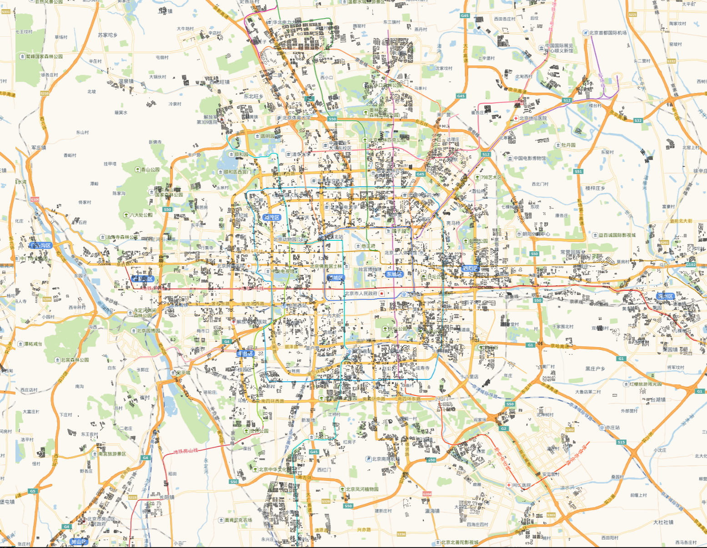

# SleepHealth: Urban Residential Sleep-Period Thermal Comfort under Climate Change

## Overview

Data and code supporting **Building-mediated heat exposure threatens urban sleep comfort in a warming climate**, submitted to *Nature Cities*.

The executable workflow reproduces the **Beijing post-processing results** from released EnergyPlus outputs: Standard Effective Temperature (SET), population-weighted sleep-period discomfort, pivot tables, installed cooling capacity and coincident cooling peaks. Processed source data and reference panels for the six study cities are provided under `figure/`.

## Repository layout

```text
SleepHealth/
├── README.md
├── LICENSE
├── requirements.txt
├── beijing_buildings_preview.png
├── code/
│   ├── run_all.py                  # Run the three-stage pipeline
│   ├── unpack_inputs.py            # Extract the released inputs
│   ├── code/                      # Calculation scripts and configuration
│   ├── data/
│   │   ├── energyplus_outputs/     # Beijing IndoorEnv, Energy and Capacity ZIPs
│   │   ├── epw/                    # City/scenario weather files
│   │   └── supporting_data/        # Building, population and energy tables
│   └── output/                    # Generated results
└── figure/                        # Figure 2–6 source data and reference panels
```



## Installation

Use **Python 3.10 or later**. From the repository root:

```bash
python -m venv .venv
```

Activate the environment:

- macOS/Linux: `source .venv/bin/activate`
- Windows Command Prompt: `.venv\Scripts\activate`
- Windows PowerShell: `.venv\Scripts\Activate.ps1`

Then install dependencies:

```bash
python -m pip install -r requirements.txt
```

The workflow uses pythermalcomfort **3.7.1**. The released simulation outputs were generated with EnergyPlus **23.2.0**; EnergyPlus is not required to run this post-processing workflow.

## Run the Beijing reproduction

From the repository root:

```bash
python code/unpack_inputs.py
python code/run_all.py --check
python code/run_all.py
```

The extraction helper unpacks all scenario ZIPs, including `_partNN.zip` files, and preserves the required directory structure. Do not rename the extracted folders or files.

The default run covers Beijing, with S1 for the 2020 baseline and S1–S5 for the six future scenarios: 2040 and 2060 under SSP1-2.6, SSP2-4.5 and SSP5-8.5. Each input category contains 1,395 files after extraction.

Capacity inputs use one `*-capacity.csv` per prototype, with one row per floor containing cooling capacity, its source and total building area.

| Strategy | Capacity | Cooling operation |
|---|---|---|
| S1 | Fixed | Nighttime, 27 °C |
| S2 | Fixed | All day, 32 °C daytime / 27 °C nighttime |
| S3 | Fixed | Nighttime, 26 °C |
| S4 | Fixed | All day, 32 °C daytime / 26 °C nighttime |
| S5 | Autosized | All day, 32 °C daytime / 26 °C nighttime |

## Outputs

Results are written to `code/output/`:

| Path | Contents |
|---|---|
| `thermal_comfort/floor_discomfort_hours.csv` | Prototype-floor discomfort hours |
| `thermal_comfort/per_capita_discomfort_hours.csv` | Population-weighted discomfort hours |
| `thermal_comfort/hourly_set/` | Detailed hourly SET workbooks |
| `pivot_tables/` | Floor-level and per-capita Excel pivots |
| `cooling_system/prototype_cooling_capacity.csv` | Installed capacity and meter checks |
| `cooling_system/city_coincident_cooling_peak.csv` | Coincident nighttime cooling peaks |
| `run_problems/` | Input or processing problems, when present |

Set `EXPORT_EXCEL=0` before running to skip detailed hourly workbooks. The pipeline stops if a stage fails. Generated results do not overwrite the figure source tables.

## Calculation settings

Discomfort is counted over the sleep period, 22:00–07:00 (nine hourly records: 23:00, 24:00 and 01:00–07:00), within the cooling period defined in each city's EnergyPlus model (16 June–15 September in Beijing), with discomfort defined as **SET > 30 °C**. Fixed settings are 0.7 met, 0.8 clo, air velocity 0.1 m/s and a relative-humidity ceiling of 60%. Atmospheric pressure is read from the matching city/scenario EPW. Settings are in `code/code/config/parameters.py`.

Population is matched by residential category, cluster and exact floor count, then divided equally among a building's floors. Per-capita discomfort is total person-hours divided by represented population; the released Beijing inputs represent approximately 71.05% of the joined residential population.

Figure 6a uses the separately supplied area-scaled electricity workbooks in `code/data/supporting_data/BuildingEnergy_new/`; these are not generated by Step 3.
